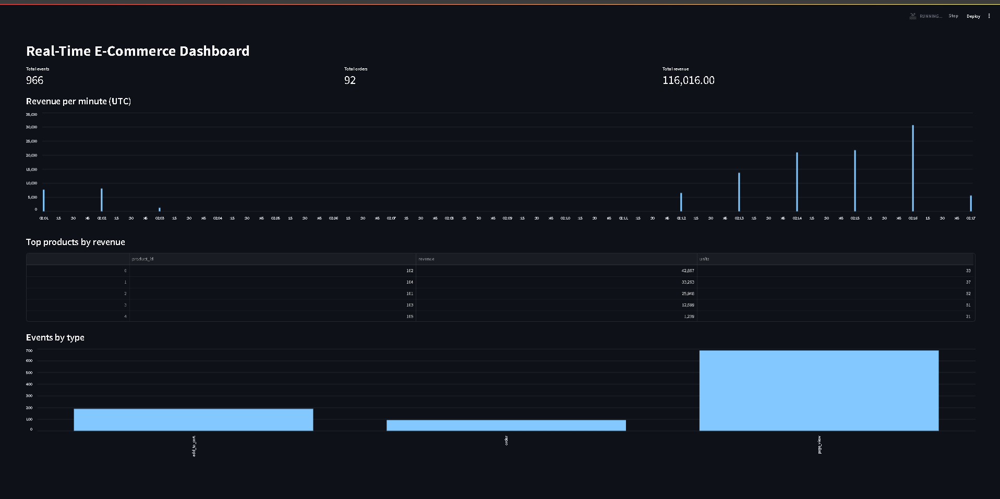

# Real-Time E-Commerce Data Platform

A streaming data pipeline that turns raw online-store events into live business metrics. A Python producer sends page views, add-to-cart clicks and orders to Apache Kafka. A consumer validates each event and stores it in PostgreSQL. A Streamlit dashboard shows total events, orders, revenue, revenue per minute and top products, refreshing every 5 seconds.

Python 3.11+.

## The problem this solves

An online store produces thousands of small events every minute. Teams that rely on nightly batch reports find out about a sales drop, a broken checkout or a trending product hours too late. Bad or duplicate events also quietly corrupt revenue numbers.

This project shows how to fix that with a streaming pipeline that:

- ingests events continuously instead of waiting for a nightly load
- validates every event before it reaches the database
- never double-counts an event, even if it is delivered twice
- keeps a raw layer for auditing and a transformed layer for fast reporting
- shows live metrics as soon as the data arrives

## Tech stack

| Purpose | Tool | Version |
|---|---|---|
| Event streaming | Apache Kafka (Docker image apache/kafka) | 3.8.0 |
| Kafka client | confluent-kafka | 2.5.3 |
| Database | PostgreSQL (Docker image) | 16 |
| Database driver | psycopg2-binary | 2.9.9 |
| Dashboard | streamlit | 1.39.0 |
| Data handling | pandas | 2.2.3 |
| Testing | pytest | 8.3.3 |
| Config / secrets | python-dotenv | 1.0.1 |
| Infrastructure | Docker Compose | - |

## Architecture

The project is split into three independent steps: producing, consuming and showing.

~~~
PRODUCING (python -m src.producer)
  random event (page_view 70% | add_to_cart 20% | order 10%)
     -> JSON with event_id, event_type, user_id, product_id, timestamp
        (orders also carry quantity and amount)
     -> sent to Kafka topic "ecommerce-events"

CONSUMING (python -m src.consumer)
  Kafka message
     -> parse JSON (bad JSON? log a warning and skip)
     -> validate required fields, event type, quantity, amount
     -> insert into raw_events (duplicate event_id? ignored)
     -> if it is an order and not a duplicate:
          insert into orders
          upsert revenue_per_minute (order_count + 1, revenue + amount)
     -> commit the Kafka offset

SHOWING (python -m streamlit run src/dashboard.py)
  every 5 seconds:
     -> query PostgreSQL
     -> total events, total orders, total revenue
     -> revenue per minute chart (last 30 minutes with data, UTC)
     -> top products by revenue
     -> events by type
~~~

Kafka and PostgreSQL run in Docker Compose. The producer, consumer and dashboard run as Python processes.

## Files

- `src/producer.py` - generates events and sends them to Kafka
- `src/consumer.py` - reads from Kafka, validates, writes to PostgreSQL
- `src/validation.py` - event validation rules
- `src/dashboard.py` - Streamlit live dashboard
- `src/config.py` - all settings in one place, read from environment variables
- `sql/init.sql` - table definitions, run automatically on first container start
- `tests/test_validation.py` - 7 unit tests for the validation rules
- `docker-compose.yml` - Kafka and PostgreSQL
- `docs/dashboard.png` - dashboard screenshot
- `logs/` - log files written by the producer and consumer (git-ignored)

## Data model

| Table | Purpose |
|---|---|
| raw_events | Every valid event as received, with the full JSON payload (audit layer) |
| orders | One row per order: user, product, quantity, amount, timestamp |
| revenue_per_minute | Order count and revenue per minute, updated as orders arrive |

## Design decisions

- **Two data layers.** raw_events keeps everything for auditing and reprocessing. orders and revenue_per_minute are shaped for fast queries. The dashboard never has to scan raw JSON.
- **Idempotent writes.** raw_events has a unique event_id and inserts use ON CONFLICT DO NOTHING. Orders and revenue are only updated when the raw insert is new, so a duplicate event can never double-count revenue.
- **At-least-once delivery.** Kafka auto-commit is turned off. The consumer commits an offset after it has handled the message, so a crash cannot silently skip events that were not processed.
- **Revenue aggregated in the database.** An upsert adds each order to its minute row, so the dashboard reads a small pre-aggregated table.
- **Timestamps in UTC.** Times on the dashboard are UTC to avoid timezone bugs.
- **One topic, keyed by user.** Events are keyed by user_id, so a user's events stay in order if the topic is later split into partitions.
- **PostgreSQL on host port 5433,** so it does not clash with another local database on 5432.

## Setup

~~~
git clone https://github.com/binnyhinn/ecommerce-data-platform.git
cd ecommerce-data-platform

python -m venv venv
.\venv\Scripts\Activate.ps1        # Mac/Linux: source venv/bin/activate
pip install -r requirements.txt

# create a .env file (see Environment variables below), then:
docker compose up -d               # start Kafka and PostgreSQL

# create the Kafka topic (first time only)
docker exec kafka /opt/kafka/bin/kafka-topics.sh --create --topic ecommerce-events --bootstrap-server localhost:9092 --partitions 1 --replication-factor 1
~~~

Run each of these in its own terminal (activate the venv in each):

~~~
python -m src.producer                       # step 1: generate events
python -m src.consumer                       # step 2: read, validate, store
python -m streamlit run src/dashboard.py     # step 3: live dashboard
~~~

The dashboard opens at http://localhost:8501

Run the tests:

~~~
python -m pytest -v
~~~

## Environment variables

Create a `.env` file in the project root. It is in `.gitignore`, so it is never committed. The values below are for a local demo database only.

~~~
POSTGRES_USER=ecom
POSTGRES_PASSWORD=ecom123
POSTGRES_DB=ecommerce
~~~

| Variable | Required | Description |
|---|---|---|
| POSTGRES_USER | Yes | PostgreSQL user, also used by Docker Compose. |
| POSTGRES_PASSWORD | Yes | PostgreSQL password, also used by Docker Compose. |
| POSTGRES_DB | Yes | Database name. |
| POSTGRES_HOST | No | Default localhost. |
| POSTGRES_PORT | No | Default 5433. |
| KAFKA_BOOTSTRAP | No | Kafka address. Default localhost:9092. |
| KAFKA_TOPIC | No | Topic name. Default ecommerce-events. |

## Simulated data

| Event type | Share of events |
|---|---|
| page_view | 70% |
| add_to_cart | 20% |
| order | 10% |

The generator simulates 500 users and 5 products. Orders are for 1 to 3 units.

In one test run the producer sent 2,840 events. At one point the dashboard showed 966 events, 92 orders and 116,016.00 in revenue.

## Environment variables

Create a `.env` file in the project root. It is in `.gitignore`, so it is never committed. The values below are for a local demo database only.

~~~
POSTGRES_USER=ecom
POSTGRES_PASSWORD=ecom123
POSTGRES_DB=ecommerce
~~~

| Variable | Required | Description |
|---|---|---|
| POSTGRES_USER | Yes | PostgreSQL user, also used by Docker Compose. |
| POSTGRES_PASSWORD | Yes | PostgreSQL password, also used by Docker Compose. |
| POSTGRES_DB | Yes | Database name. |
| POSTGRES_HOST | No | Default localhost. |
| POSTGRES_PORT | No | Default 5433. |
| KAFKA_BOOTSTRAP | No | Kafka address. Default localhost:9092. |
| KAFKA_TOPIC | No | Topic name. Default ecommerce-events. |

## Simulated data

| Event type | Share of events |
|---|---|
| page_view | 70% |
| add_to_cart | 20% |
| order | 10% |

The generator simulates 500 users and 5 products. Orders are for 1 to 3 units.

In one test run the producer sent 2,840 events. At one point the dashboard showed 966 events, 92 orders and 116,016.00 in revenue.

## Example queries

Run these against the database to check the data directly:

~~~
docker exec -it ecom_postgres psql -U ecom -d ecommerce -c "SELECT event_type, COUNT(*) FROM raw_events GROUP BY event_type;"
~~~

~~~
docker exec -it ecom_postgres psql -U ecom -d ecommerce -c "SELECT * FROM revenue_per_minute ORDER BY minute DESC LIMIT 5;"
~~~

~~~
docker exec -it ecom_postgres psql -U ecom -d ecommerce -c "SELECT product_id, SUM(amount) AS revenue, SUM(quantity) AS units FROM orders GROUP BY product_id ORDER BY revenue DESC;"
~~~

## Testing

The 7 tests cover valid page views and orders, a missing field, an unknown event type, a zero quantity, a negative amount, and input that is not an object.

## Known limitations

- The data is simulated. There is no real store behind the producer.
- One Kafka partition and one consumer, so throughput is limited to what a single consumer can handle.
- If an event fails to save because of a database error, the error is logged but the offset is still committed, so that event is not retried.
- Invalid events are logged and skipped. They are not kept anywhere (no dead-letter topic), so they cannot be inspected later.
- The dashboard re-queries PostgreSQL every 5 seconds. It is near real time, not a push stream.
- Revenue has no currency. Amounts are plain numbers.
- The producer, consumer and dashboard are not containerised yet. Only Kafka and PostgreSQL are.
- Only the validation rules have unit tests. The Kafka and database code has no automated tests.
- The demo database password is for local use only and should be changed for anything real.

## Possible improvements

- Dead-letter topic for invalid events, and retries for events that fail to save
- Run the producer, consumer and dashboard as Docker services
- Multiple Kafka partitions and consumers for higher throughput
- Batch rollups with Airflow or dbt
- Alerts when revenue per minute drops sharply

## Author

**R. Binny Hinn**
Python and Data Engineering | AI and ML graduate (CSE, 2026)

- GitHub: [github.com/binnyhinn](https://github.com/binnyhinn)
- LinkedIn: [linkedin.com/in/binny-hinn-4303873ba](https://www.linkedin.com/in/binny-hinn-4303873ba)
- Email: [binnyhinnr@gmail.com](mailto:binnyhinnr@gmail.com)
